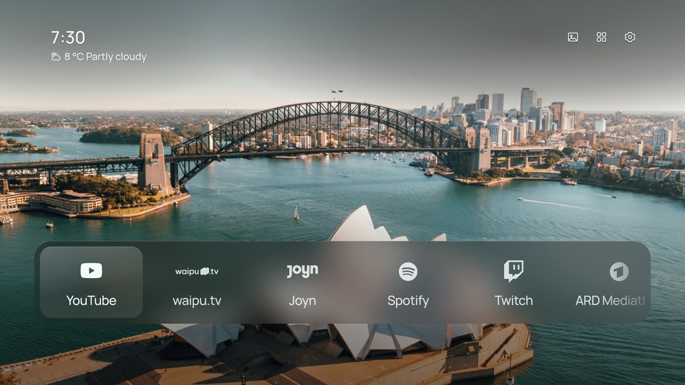
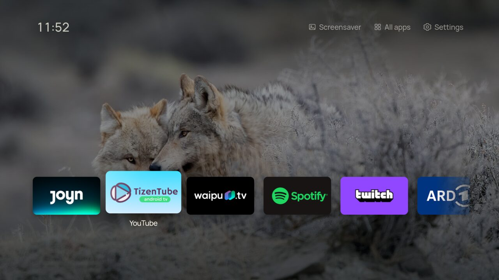
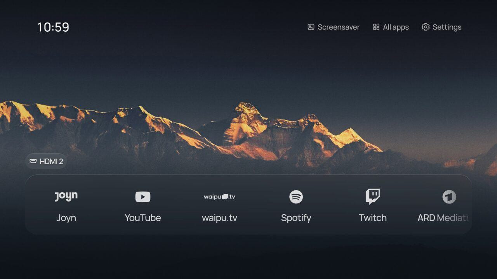
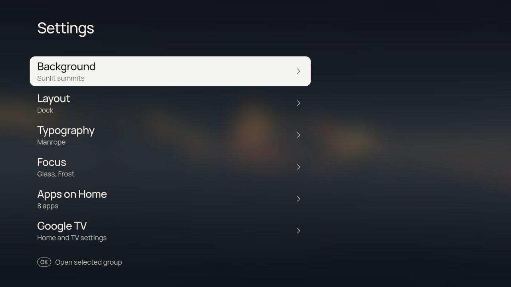
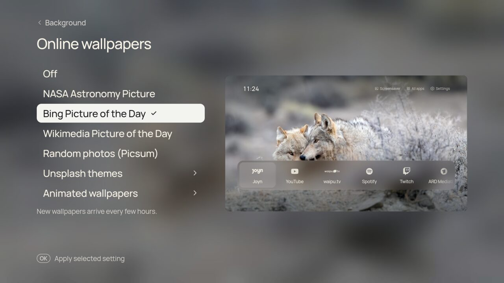
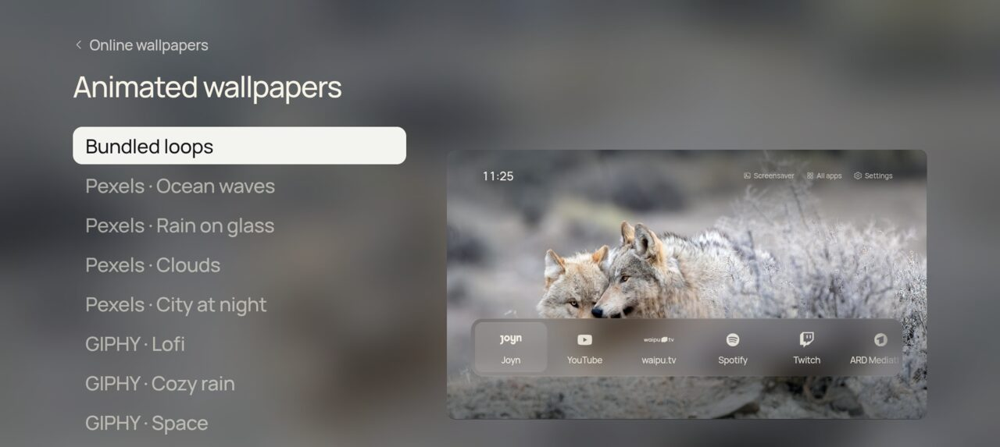
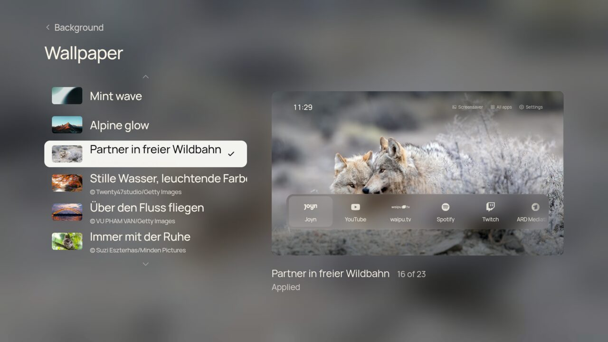
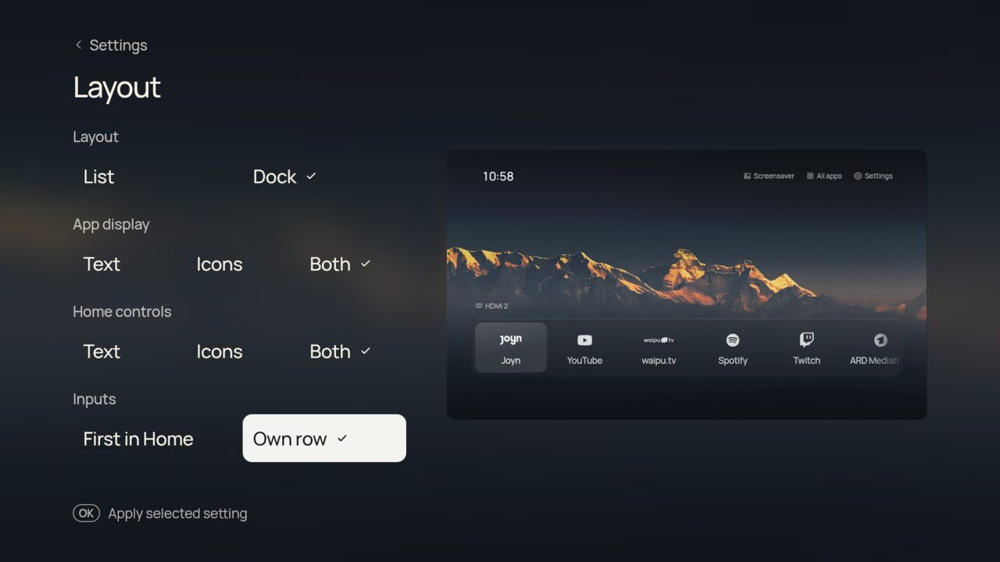

# CleanFrame for TCL Google TV

A calm, uncluttered home screen for TCL Google TVs: your apps, your HDMI devices, a beautiful wallpaper and the time, made for the remote.





CleanFrame-TCL is a port of [Nathan Clark's CleanFrame](https://github.com/nthnclrk/CleanFrame) (built for Samsung The Frame / Tizen) to **Android TV / Google TV**, tuned and tested on a **TCL 55C6KS** (55" Mini LED, 4K, Google TV on Android TV 12, firmware `V8-0008T01-LF1V548.002110`). The interface is the same HTML/CSS/ES5 app; a small Java shell runs it full screen and connects it to the TV.

> **Unofficial.** Not affiliated with TCL, Google, Samsung or any streaming service. Use at your own risk; everything here is reversible, and the steps below say how.

## Features

- **Dock, List or Shelf layout.** Shelf is an Apple TV–inspired row of each app's own colourful Android TV banner; the focused card lifts with a sheen. Dock and List draw app logos in one consistent style.
- **Installed apps** discovered automatically; pick and order up to nine for Home.
- **HDMI inputs that appear by themselves.** Switch a console or set-top box on and its tile shows up instantly; switch it off and it disappears. Show them first in Home or in their own row.
- **Remote Home button opens CleanFrame** (optional accessibility service). Hold Home for the original Google TV Home.
- **15 bundled photographs** with pre-rendered glass, plus **online wallpapers**:
  - NASA Astronomy Picture of the Day
  - Bing Picture of the Day
  - Wikimedia Commons Picture of the Day
  - Random photos (Picsum)
  - Unsplash themes: Nature and landscapes, Cities and architecture, Night sky and space *(API key)*
- **Animated wallpapers**: bundled seamless loops, Pexels HD video loops *(API key)* and Klipy GIFs *(API key)* with preset keywords.
- **Drift motion**: a slow Ken Burns zoom where the photo and its glass move together.
- **Night mode**: dims the wallpaper, video and glass together on a timer (21–07, 22–06 or 23–07) or always, in three strengths.
- **Clock**: 12- or 24-hour, optional date, four sizes and weights.
- **Text**: font, text weight and app-name size.
- **Hide controls when idle**: after 1 or 5 minutes only the picture and clock stay; any button brings them back.
- Animations pause automatically outside Home (Settings, All apps), so menus stay snappy.
- **Rotation**: a new wallpaper every time Home opens, or every 5, 15 or 60 minutes.
- **Eight fonts** (all Open Font License): Manrope, Geist, Newsreader, Inter, Outfit, Space Grotesk, Sora and Playfair Display, with matched metrics so the clock and labels never jump.
- Focus style and glass materials, all in the same remote-friendly Settings.
- An optional, reversible **debloat** list for TCL's preinstalled extras.

| | |
| --- | --- |
|  |  |
|  |  |
|  |  |

Bundled animated loops (previews; on the TV they play at 1080p behind the interface):

| Aurora | Dusk | Deep sea |
| --- | --- | --- |
|  |  |  |

## Install on the TV

You need a computer on the same Wi-Fi with [Android platform tools](https://developer.android.com/tools/releases/platform-tools) (`adb`).

1. **Enable developer options.** On the TV: *Settings → System → About*, scroll to **Android TV OS build** and press OK **seven times** until "You are now a developer". Use the main (admin) profile; kids profiles hide this.
2. **Turn on debugging.** *Settings → System → Developer options* → **USB debugging** on. (Some builds also show **Wireless debugging**; see below.)
3. **Connect** (replace `<tv-ip>` with the TV's address from *Settings → Network*):

   ```sh
   adb connect <tv-ip>:5555
   ```

   A prompt "Allow debugging?" appears on the TV: tick **Always allow from this computer** and press OK.

   *Android 14 builds with "Wireless debugging":* open it → **Pair device with pairing code**, then `adb pair <ip>:<pair-port> <code>` and `adb connect <ip>:<port>` (the pairing port differs from the connect port).
4. **Install** the APK from [Releases](https://github.com/taynotfound/CleanFrame-TCL/releases) (or build it, below):

   ```sh
   adb install -r CleanFrame-TCL.apk
   ```

CleanFrame now appears in your Apps. Open it once; it remembers everything locally.

### Make the Home button open CleanFrame

Google TV always sends Home to its own launcher and ignores Android's "default home app" setting. CleanFrame includes a tiny accessibility service that catches the Home key instead (the same approach launchers such as Projectivy use). Turn it on yourself on the TV:

**Settings → System → Accessibility → CleanFrame Home button → On**

- **Press Home**: CleanFrame.
- **Hold Home** (about a second): the original Google TV Home. *Settings → Google TV → Google TV Home* inside CleanFrame does the same.
- If Google TV Home appears by itself (for example after leaving an app), CleanFrame takes over, unless you opened it on purpose.

The service only listens for remote keys and which app is in front. It never reads screen content, and nothing is disabled. Turn the switch off to undo.

### Reassign remote buttons

*Settings → Google TV → Remote buttons* (needs the accessibility service above). Choose **Assign a button…**, press the button on the remote, then pick what it does:

- **Default**: what the TV normally does (removes the assignment).
- **CleanFrame Home**, **Do nothing** or **Screensaver**.
- A **connected HDMI input**, or **an app** from your Home screen.

Assignments are stored on the TV and work everywhere, including inside other apps. Choose a button in the list to change it.

Limits:

- Only buttons that reach Android's accessibility key filter can be reassigned. If the TV firmware handles a button first, CleanFrame never sees it and the page says *No button arrived* instead of pretending.
- Navigation, OK, Back, Home, volume and power are never captured (Home already has its own behaviour above).
- Two physical buttons that send the same Android key code share one assignment.
- Verified on the TCL RC833 remote: *not yet tested on hardware.*

### HDMI inputs

Inputs come from Android's TV Input Framework, using the TV's own state events: a device that is **plugged in and switched on** gets a tile; standby or unplugged devices are hidden. OK switches the TV to that input. If you rename an input in the TV settings, CleanFrame uses that name. Choose **Settings → Layout → Inputs → First in Home** or **Own row**.

## Online and animated wallpapers

*Settings → Background → Online wallpapers.* The TV downloads up to eight images or clips from the chosen source, then renders the same files the bundled gallery ships with (photo, thumbnail and four pre-blurred glass layers) **once, on download**. Nothing is blurred live, so Home stays smooth. New wallpapers arrive every few hours, and rotation then cycles through that source.

Animated wallpapers play as muted MP4 loops behind the interface. Their glass is rendered from the first frame. Klipy GIFs are fetched as their MP4 versions, which are far lighter than GIF files.

NASA (shared `DEMO_KEY`), Bing, Wikimedia, Picsum and the bundled loops work without keys. For Unsplash, Pexels and Klipy, create free developer keys and put them in `android/local.properties` (ignored by git), or pass them as environment variables when building:

```properties
unsplash.accessKey=...   # https://unsplash.com/developers
pexels.apiKey=...        # https://www.pexels.com/api/
klipy.apiKey=...         # https://partner.klipy.com/ (KLIPY GIF API)
nasa.apiKey=...          # optional, https://api.nasa.gov/ (default DEMO_KEY is rate limited)
```

Keys are compiled into your APK, so don't share an APK that contains your keys. Credits for each photo or clip appear in the wallpaper gallery, as the sources' terms ask.

## Top Shelf (Shelf layout)

*Settings → Layout → Shelf.* Like the Apple TV Top Shelf, the focused app's backdrop fills the screen with what is trending there, and **Down** opens a row of recommendations. **OK** opens an item in its app where the app accepts a link (YouTube, Twitch, ZDF, ARTE), otherwise it opens the app. **Up** or **Back** returns to the apps.

Google TV doesn't share its recommendation rows with other launchers, so CleanFrame reads public catalogues instead, about once an hour, over HTTPS only. Images are resized once on download. ARD Mediathek, ZDF and ARTE work without keys. Netflix, Disney+, Prime Video, Joyn, waipu.tv and Apple TV use [TMDB](https://www.themoviedb.org) watch providers for Germany. YouTube and Twitch need their own keys. Apps without recommendations show their TV banner, softly blurred, as the backdrop. Add the keys to `android/local.properties`, or set them as environment variables (`TMDB_TOKEN`, `YOUTUBE_API_KEY`, `TWITCH_CLIENT_ID`, `TWITCH_CLIENT_SECRET`, also used as GitHub Actions secrets):

```properties
tmdb.token=...           # TMDB "API Read Access Token" (v4 Bearer), https://www.themoviedb.org/settings/api
youtube.apiKey=...       # YouTube Data API v3 key, https://console.cloud.google.com/apis/library/youtube.googleapis.com
twitch.clientId=...      # https://dev.twitch.tv/console/apps
twitch.clientSecret=...
```

## Build from source

Requirements: JDK 17 and the Android SDK (platform 35), or Android Studio.

```sh
git clone https://github.com/taynotfound/CleanFrame-TCL.git
cd CleanFrame-TCL
echo "sdk.dir=$HOME/Android/Sdk" > android/local.properties
gradle -p android assembleRelease        # Gradle 8.11
adb install -r android/app/build/outputs/apk/release/app-release.apk
```

Without signing secrets the APK is signed with your machine's debug key. Keep using the same key to update in place without losing settings. The GitHub Actions workflow (`.github/workflows/android.yml`) builds the APK on every push.

The web UI also runs in a desktop browser for quick design work: `npm ci && npm run dev:public`, then open [localhost:4795/home/](http://localhost:4795/home/). Run `npm run check` after changing `app/`.

### Project layout

| Path | What it is |
| --- | --- |
| `app/` | The CleanFrame web UI (shared with the Tizen version) |
| `app/device-android.js` | Android adapter: apps, inputs, online wallpapers |
| `android/` | Java shell: WebView, app and input bridge, Home button service, wallpaper downloader |
| `android/app/src/main/assets-android/loops/` | Bundled animated loops (generated, original) |
| `debloat/` | Optional, reversible debloat list and script |
| `docs/android-tv.md` | Port notes; `docs/upstream-README.md` is the original Samsung README |

## Optional: debloat

`debloat/packages.txt` lists TCL and Google extras that are safe to switch off: Samba TV tracking, promo overlays, the store demo, Alexa and so on, each with a comment. Edit the list, then:

```sh
TV=<tv-ip>:5555 debloat/debloat.sh disable   # turn them off (pm disable-user, nothing is uninstalled)
TV=<tv-ip>:5555 debloat/debloat.sh status
TV=<tv-ip>:5555 debloat/debloat.sh restore   # turn them back on
```

Live TV, inputs, settings, the remote, AirPlay/Miracast, updates and Google TV itself are never in the list. Firmware updates or a factory reset may re-enable apps.

## Ideas and roadmap

- Weather and calendar on the clock (Open-Meteo, no key)
- "Now playing" card from the active media session
- HDMI-CEC device names ("PlayStation 5" instead of "HDMI 1")
- Sunrise/sunset wallpaper switching and a night dim mode
- Upload your own photos and GIFs from your phone over Wi-Fi
- Update notifications from GitHub Releases

## Credits and licences

- **CleanFrame** by Nathan Clark: MIT. This fork keeps the original licence and notices ([LICENSE](LICENSE), [THIRD_PARTY_NOTICES.md](THIRD_PARTY_NOTICES.md)).
- Android TV port, inputs, Home button, online/animated wallpapers and TCL tuning: CleanFrame-TCL contributors, MIT.
- App logos: [Simple Icons](https://simpleicons.org) (CC0) and public-domain wordmarks from Wikimedia Commons. See `app/assets/icons/SOURCES.json`. Trademarks belong to their owners.
- Online wallpapers belong to their authors and are shown under each provider's terms: [NASA APOD](https://apod.nasa.gov), [Bing](https://www.bing.com), [Wikimedia Commons](https://commons.wikimedia.org), [Lorem Picsum](https://picsum.photos), [Unsplash](https://unsplash.com), [Pexels](https://www.pexels.com), [KLIPY](https://klipy.com) ("Powered by KLIPY").
- Bundled animated loops are generated procedurally for this project.
- Top Shelf: This product uses the TMDB API but is not endorsed or certified by TMDB. Recommendations and images come from [TMDB](https://www.themoviedb.org), [ARD Mediathek](https://www.ardmediathek.de), [ZDF](https://www.zdf.de), [ARTE](https://www.arte.tv), [YouTube](https://www.youtube.com) and [Twitch](https://www.twitch.tv) under their terms; titles and artwork belong to their owners.
