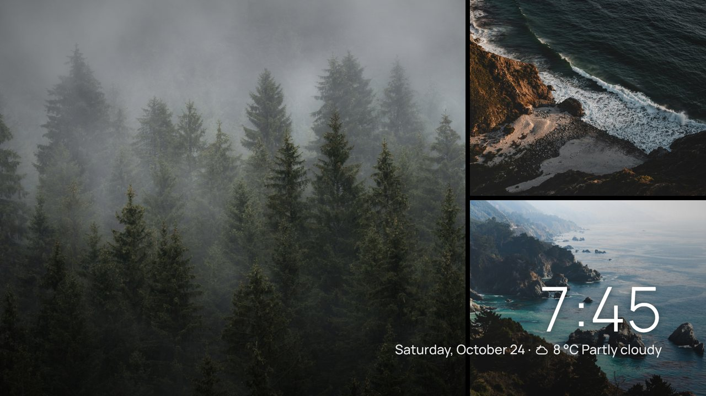
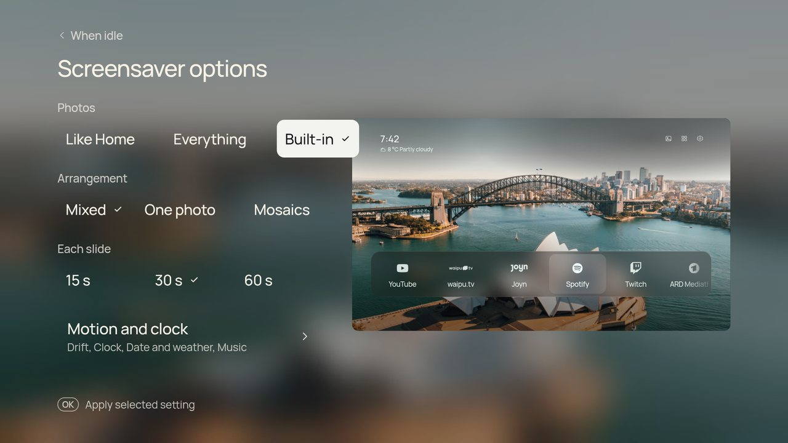

<div align="center">



# Shore

**A calm home screen for Google TV: your apps, your HDMI devices, a beautiful picture and the time. Nothing else.**

[Website](https://taynotfound.github.io/shore/) · [Install](#install) · [Features](#features) · [Phone companion](#phone-companion) · [Wallpapers](#online-and-animated-wallpapers) · [Top Shelf](#top-shelf) · [Build](#build-from-source)


</div>

Shore (formerly CleanFrame-TCL) brings [Nathan Clark's CleanFrame](https://github.com/nthnclrk/CleanFrame), originally made for Samsung The Frame, to **Android TV and Google TV**. It is tuned and tested on a **TCL 55C6KS** (55" Mini LED, 4K, Android TV 12). The interface is the original HTML/CSS app; a small Java shell runs it full screen and connects it to the TV.

> [!NOTE]
> **Unofficial.** Not affiliated with TCL, Google, Samsung or any streaming service. Everything here is reversible, and each step says how.

## Features


**Home, your way**
- **Three layouts.** *Dock* and *List* draw every app logo in one consistent style. *Shelf* is an Apple TV–style row of each app's colourful banner, with a [Top Shelf](#top-shelf) above it.
- **Your apps, found automatically.** Pick and order up to nine for Home.
- **HDMI devices appear by themselves**, named by HDMI-CEC ("PlayStation 5" instead of "HDMI 1"). Switch on a console or set-top box and its tile shows up; switch it off and it disappears. Show inputs first on Home or in their own row.
- **Speaks your language.** The launcher follows the TV's system language (*Settings → System → Language*). German, French, Spanish, Dutch and Polish are included; anything else falls back to English.

**The picture**
- **15 photographs** with pre-rendered glass, plus **online wallpapers** from NASA, Bing, Wikimedia, Picsum and Unsplash.
- **Animated wallpapers**: bundled seamless loops, Pexels video loops and Klipy GIFs.
- **[Phone companion](#phone-companion)**: scan a QR code and send photos, GIFs and short videos to the TV, from a web app styled like the launcher.
- **Drift**: a slow Ken Burns zoom where the photo and its glass move together.
- **Rotation**: a new picture each time Home opens, or every 5, 15 or 60 minutes.
- **Night mode** dims everything on a timer (21–07, 22–06, 23–07) or all the time, in three strengths.

**Make it yours**
- **Eight open-licence fonts**, with text weight and app-name size.
- **Clock**: 12- or 24-hour, optional date, four sizes and weights.
- **[Under the clock](#under-the-clock-weather-and-now-playing)**: the current weather in °C or °F (Open-Meteo, no key) and what's playing in Spotify, YouTube or any other app.
- **Hide controls when idle**: after 1 or 5 minutes only the picture and clock stay.
- Focus style and glass materials.

**Fits the TV**
- **The Home button opens Shore.** Hold Home for the original Google TV Home.
- **Reassign remote buttons** such as the app shortcut keys or the TV button.
- Animations pause outside Home, so menus stay snappy.
- An optional, reversible **debloat** list for TCL's preinstalled extras.

| | |
| --- | --- |
|  |  |
|  |  |
|  |  |
|  |  |

<table>
<tr><th>Aurora</th><th>Dusk</th><th>Deep sea</th></tr>
<tr>
<td></td>
<td></td>
<td></td>
</tr>
</table>

<sub>Bundled animated loops. On the TV they play at 1080p behind the interface.</sub>

## Install

You need a computer on the same Wi-Fi with [Android platform tools](https://developer.android.com/tools/releases/platform-tools) (`adb`).

1. **Enable developer options.** On the TV, open *Settings → System → About*. Press OK on **Android TV OS build** seven times, until "You are now a developer" appears. Use the main profile; kids profiles hide this.
2. **Turn on debugging.** *Settings → System → Developer options → USB debugging*.
3. **Connect**, replacing `<tv-ip>` with the address from *Settings → Network*:

   ```sh
   adb connect <tv-ip>:5555
   ```

   The TV asks "Allow debugging?". Tick **Always allow from this computer** and press OK.
4. **Install** the APK from [Releases](https://github.com/taynotfound/shore/releases) or [build it](#build-from-source):

   ```sh
   adb install -r Shore.apk
   ```

Shore now appears in your apps. Open it once; it remembers everything on the TV.

<details>
<summary>Android 14 builds with "Wireless debugging"</summary>

Open *Wireless debugging → Pair device with pairing code*, then run `adb pair <ip>:<pair-port> <code>` and `adb connect <ip>:<port>`. The pairing port is different from the connect port.

</details>

### Make the Home button open Shore

Google TV always sends Home to its own launcher and ignores the "default home app" setting. Shore includes a small accessibility service that catches the Home key instead, the same approach launchers like Projectivy use. Turn it on yourself:

**Settings → System → Accessibility → Shore Home button → On**

- **Press Home** to open Shore.
- **Hold Home** for about a second to open the original Google TV Home. *Settings → Google TV → Google TV Home* in Shore does the same.
- If Google TV Home appears by itself, for example after leaving an app, Shore takes over. It won't do that if you opened Google TV Home on purpose.

The service only sees remote keys and which app is in front. It never reads screen content. Turn the switch off to undo.

> [!IMPORTANT]
> **TCL TVs: allow auto start.** After a restart, TCL's boot manager refuses to start accessibility services of apps without its *auto start* permission. The switch then still shows *Enable* on, but the service shows *Off* and no button works. Shore's *Remote buttons* page says so when this happens. Allow Shore to auto start in TCL's **TV Guard** (permission manager), then switch *Shore Home button* off and on once.

### Reassign remote buttons

*Settings → Google TV → Remote buttons* (needs the accessibility service). Choose **Assign a button…**, press a button on the remote, then pick what it does:

- **Default**: what the TV normally does. This removes the assignment.
- **Shore Home**, **Do nothing** or **Screensaver** (Shore's own, see below).
- A **connected HDMI input**, or **an app** from your Home screen.

Assignments work everywhere, including inside other apps.

<details>
<summary>Limits</summary>

- Shore only sees buttons that reach Android's accessibility key filter. If the TV firmware handles a button first, the page says *No button arrived*.
- Navigation, OK, Back, Home, volume and power are never captured.
- Two buttons that send the same Android key code share one assignment.
- Not yet tested on the TCL RC833 remote itself.

</details>

### HDMI inputs

Inputs come from Android's TV Input Framework. A device that is **plugged in and switched on** gets a tile; standby or unplugged devices are hidden. OK switches the TV to that input, and inputs you rename in the TV settings keep their name. Otherwise a tile uses the name the device announces over HDMI-CEC, such as *PlayStation 5* or *Apple TV*. CEC must be on in the TV settings (TCL calls it *T-Link*); without it the port name, such as *HDMI 1*, is shown. Choose *Settings → Layout → Inputs → First in Home* or *Own row*.

### Language

Shore uses the TV's system language: German, French, Spanish, Dutch and Polish are built in, and anything else shows English. Change it in *Settings → System → Language* on the TV, then reopen Shore. Translations live in [`app/i18n.js`](app/i18n.js): one dictionary per language, keyed by the English text, so adding a language means adding one block. In the browser preview, `?lang=de` picks a language.

### Under the clock: weather and Now playing

*Settings → Clock → Under the clock.*

- **Weather** shows the temperature and sky, such as *12 °C Cloudy*, next to the date. It comes from [Open-Meteo](https://open-meteo.com), which needs no key or account. The place is the city of the TV's time zone (*Europe/Berlin* → Berlin), or the place you type in the [phone companion](#phone-companion). Choose **°C or °F** under *Temperature*. Shore refreshes the weather every 30 minutes, and it is off until you turn it on.
- **Now playing** shows a small moving level meter and *Title · Artist — App* while something plays in another app, for example Spotify in the background. Android only shares media sessions with apps that have notification access. So allow **Shore Now playing** under *Settings → Apps → Special app access → Notification access*; the Clock page has a shortcut. Shore reads only the active media session and ignores notifications themselves. The level meter is decoration: Shore never hears the audio.
- **Album art** (*Background*): while music with a cover plays, the cover becomes the background, softly blurred and dimmed, and the glass shows it through. It needs a Photo background and goes back to your wallpaper when the music stops. The blur is made once per track on the TV's CPU, not live in the page. Turn it off in *Settings → Background → Online and album art*.
- **Sharper pictures** (same page, on by default): media apps often share only a small cover, which looks soft at TV size. Shore then looks up a wide artist picture on [TheAudioDB](https://www.theaudiodb.com) and, if none fits, a 1000-pixel cover from the [iTunes Search API](https://performance-partners.apple.com/search-api). Only the artist name (and title for iTunes) is sent, once per track; results are cached on the TV for 30 days. Turn it off to keep everything on the TV.
- **Weather icons** next to the temperature follow the sky and switch to night versions after sunset. *Under the clock → Details* hides the icon or the level meter.

### Screensaver

*Settings → Night and idle → When idle.* Shore has its own screensaver instead of the TV's: after 5, 10 (default) or 15 minutes without a button press it fades to a slow slideshow of your wallpapers (the current rotation source, including My photos). Photos drift slowly, and every few slides it shows a mosaic of two or three photos at once. A large clock, the date and the weather sit on top. While music plays it adds a small card with the cover, title and artist; the album art never replaces the photos. The clock moves to another corner every few minutes so nothing sits on the same pixels for hours. Any button wakes Shore without doing anything else. *Start the screensaver now* is on the same page, and the **Screensaver** button on Home and the *Screensaver* remote-button action start it too.

*Screensaver options* on the same page choose the photos (*Like Home*, which adds Shore's wallpapers when your rotation has only a few; *Everything*; or *Built-in*), the arrangement (mixed, one photo or mosaics) and 15, 30 or 60 seconds per slide. *Motion and clock* switches the slow pan off and hides the clock, the date and weather or the music card.

While Shore's screensaver is on and Shore is in front, Shore keeps the TV's own screensaver away. After four hours of screensaver it lets go, so the TV's usual sleep timer still turns the TV off. Choose *Off* to leave everything to the TV.

<details>
<summary>Use Shore as the screensaver everywhere (optional)</summary>

The APK also contains Shore as a system screensaver (`ShoreDream`), for when the TV goes idle inside another app. Google TV doesn't list third-party screensavers in its settings, so it can only be picked over ADB. Note the current value first so you can restore it:

```bash
adb shell settings get secure screensaver_components
adb shell settings put secure screensaver_components app.cleanframe.tv/.ShoreDream
```

To undo, put back the value from the first command.

</details>

<details>
<summary>Google TV hides Notification access</summary>

Some Google TV builds don't show the Notification access page. In that case you can allow it once from a computer on the same network, using ADB:

```bash
adb shell cmd notification allow_listener app.cleanframe.tv/app.cleanframe.tv.NowPlayingService
```

To undo, run the same command with `disallow_listener`.

</details>

## Phone companion

*Settings → Phone → Phone companion.* Turn it on and the TV shows a QR code. Scan it with your phone's camera and tap **Install app**: Shore Companion lands on your home screen. Opening it takes you to a small web app served by the TV itself, styled like the launcher, with your current wallpaper behind glass cards.

- **Send to your TV**: pick photos (JPEG, PNG, WebP), GIFs or MP4 clips. Each photo first opens in a 16:9 frame, the TV's shape: drag to move it, pinch or use the slider to zoom, then **Send**. *Whole photo* sends it uncropped, *Skip* leaves it out. The crop is made on the phone at the photo's own resolution (up to 3840 px wide). They appear under **My photos**, a wallpaper source like the others. Glass is rendered once, rotation cycles through them, and GIFs and clips play animated. Choose *Settings → Phone → My photos* to use them.
- **My photos**: see what's stored and delete single photos or all of them. Shore keeps the newest 30, in its private storage on the TV.
- **Weather place**: the city for the weather under the clock.
- **Install it**: the QR code opens [taynotfound.github.io/shore/app](https://taynotfound.github.io/shore/app/), a tiny installable page (HTTPS, manifest, offline cache). It remembers your TV and opens it whenever you start the app. If your browser shows no install button, use its menu: *Install app* or *Add to Home screen*. On iPhone: *Share → Add to Home Screen*.

**Privacy and limits**

- Nothing goes through the internet. Phone and TV must be on the same Wi-Fi, and the companion only runs while it's switched on.
- The QR code carries a random pairing key, which the phone keeps. Without it the TV answers nothing but the page itself. *Forget paired phones* makes a new key, and every phone has to scan again.
- Why two pages: browsers only install HTTPS sites, and a TV can't get a trusted certificate on a home network. So the installable part lives on the website, and the TV keeps serving the real page over `http://` on your Wi-Fi. The TV address and pairing key travel after the `#` in the link, which browsers never send to the website, and stay on your phone. The TV also shows its address for use without internet.
- If the TV's IP address changes, scan the code again. A DHCP reservation in your router avoids that.
- Forks: change `Companion.PAIR_URL` to your own GitHub Pages address.

## Online and animated wallpapers

*Settings → Background → Online wallpapers.* The TV downloads up to eight pictures or clips from the chosen source. On download it renders them once into the same files the bundled gallery uses: photo, thumbnail and four pre-blurred glass layers. Nothing is blurred live, so Home stays smooth. New wallpapers arrive every few hours, and rotation cycles through them.

Animated wallpapers play as muted MP4 loops, with glass rendered from the first frame. Klipy GIFs are fetched as MP4s, which are much lighter than GIF files.

NASA, Bing, Wikimedia, Picsum and the bundled loops work without keys. Unsplash, Pexels and Klipy need free developer keys. Put them in `android/local.properties` (ignored by git), or pass them as environment variables when building:

```properties
unsplash.accessKey=...   # https://unsplash.com/developers
pexels.apiKey=...        # https://www.pexels.com/api/
klipy.apiKey=...         # https://partner.klipy.com/
nasa.apiKey=...          # optional, https://api.nasa.gov/ (the default DEMO_KEY is rate limited)
```

> [!WARNING]
> Keys are compiled into your APK, so don't share an APK that contains them.

Credits for each picture appear in the wallpaper gallery, as the sources' terms ask.

## Top Shelf

*Settings → Layout → Shelf.* As on Apple TV, the focused app fills the screen with what is trending there. **Down** opens a row of recommendations. **OK** opens an item directly in YouTube, Twitch, ZDF or ARTE, and opens the app itself for the others. **Up** or **Back** returns to the apps.

Google TV doesn't share its recommendations with other launchers, so Shore reads public catalogues about once an hour, over HTTPS only:

| Apps | Source | Key |
| --- | --- | --- |
| ARD Mediathek, ZDF, ARTE | Their own public catalogues | None |
| Netflix, Disney+, Prime Video, Joyn, waipu.tv, Apple TV | [TMDB](https://www.themoviedb.org) watch providers for Germany | `tmdb.token` |
| YouTube | YouTube Data API v3 | `youtube.apiKey` |
| Twitch | Twitch Helix API | `twitch.clientId`, `twitch.clientSecret` |

<details>
<summary>Getting the Twitch keys (no login or user token needed)</summary>

Shore asks Twitch for an **app access token** by itself (the *client credentials* flow), so you never sign in or paste a token. You need two values from your own Twitch application:

1. Open the [Twitch developer console](https://dev.twitch.tv/console/apps) and choose **Register Your Application**. Turn on two-factor authentication first if Twitch asks for it.
2. **Name**: anything unique, for example `Shore-TV-yourname`. **OAuth Redirect URLs**: `http://localhost`. Twitch requires one, but Shore never uses it. **Category**: *Application Integration*. **Client type**: *Confidential*.
3. Open the application with **Manage**. Copy the **Client ID**, then choose **New Secret** and copy the **Client Secret**. Twitch shows it only once.
4. Add both to `android/local.properties` and rebuild:

   ```properties
   twitch.clientId=your-client-id
   twitch.clientSecret=your-client-secret
   ```

To check the pair before building, ask Twitch for a token yourself. A JSON reply with `access_token` means the keys work:

```bash
curl -X POST "https://id.twitch.tv/oauth2/token" -d "client_id=YOUR_ID" -d "client_secret=YOUR_SECRET" -d "grant_type=client_credentials"
```

Authorize links (`https://id.twitch.tv/oauth2/authorize?…`) and token generator websites create *user* tokens, which Shore doesn't use. Never paste a user token anywhere: it can act as your account. If you made one, revoke it under twitch.tv → *Settings → Connections*.

</details>

Apps without recommendations show their own banner, softly blurred. Keys go in `android/local.properties`, or the environment variables `TMDB_TOKEN`, `YOUTUBE_API_KEY`, `TWITCH_CLIENT_ID` and `TWITCH_CLIENT_SECRET` (also used as GitHub Actions secrets).

## Build from source

You need JDK 17 and the Android SDK (platform 35), or Android Studio.

```sh
git clone https://github.com/taynotfound/shore.git
cd shore
echo "sdk.dir=$HOME/Android/Sdk" > android/local.properties
gradle -p android assembleRelease
adb install -r android/app/build/outputs/apk/release/app-release.apk
```

Without signing secrets, the APK is signed with your computer's debug key. Keep using the same key so updates install in place and keep your settings. GitHub Actions builds the APK on every push.

The interface also runs in a desktop browser for design work: `npm ci && npm run dev:public`, then open [localhost:4795/home/](http://localhost:4795/home/). Run `npm run check` and `npm run check:browser` after changing `app/`.

| Path | What it is |
| --- | --- |
| `app/` | The Shore interface, shared with the Samsung version |
| `app/device-android.js` | Android adapter: apps, inputs, wallpapers, remote buttons |
| `app/i18n.js` | Translations |
| `android/` | Java shell: WebView, app and input bridge, Home button service, wallpaper and Top Shelf downloaders |
| `debloat/` | Optional, reversible debloat list and script |
| `docs/android-tv.md` | Port notes. [`docs/upstream-README.md`](docs/upstream-README.md) is the original Samsung README |

## Optional: debloat

[`debloat/packages.txt`](debloat/packages.txt) lists TCL and Google extras that are safe to switch off, such as Samba TV tracking, promo overlays, the store demo and Alexa, each with a comment. Edit the list, then:

```sh
TV=<tv-ip>:5555 debloat/debloat.sh disable   # switch them off (nothing is uninstalled)
TV=<tv-ip>:5555 debloat/debloat.sh status
TV=<tv-ip>:5555 debloat/debloat.sh restore   # switch them back on
```

Live TV, inputs, settings, the remote, casting, updates and Google TV itself are never on the list. A firmware update or factory reset may switch apps back on.

## Ideas

Built since the last list: weather with °C/°F, Now playing with album art, Shore's own screensaver, cropping in the phone companion, HDMI-CEC names, and German, French, Spanish, Dutch and Polish. Next up:

- Play/pause and skip for Now playing
- A sleep timer on a remote button
- Use the phone companion as a remote and keyboard
- Calendar events under the clock (ICS link)
- Italian and Turkish translations

## Brand

The half sun over three lines in ivory `#e3e6dc`, on a deep blue-grey gradient (`#20303a` → `#0f161a`) with a warm accent `#f2c58b`, set in Manrope. The same mark is the TV icon, the launcher banner, the website and the phone companion. [`docs/brand/`](docs/brand/) holds the animated banner (SVG, GIF, MP4), the logo and mark, and ready-made ads (1200×628 and 1080×1080, as PNG and MP4). `python3 scripts/brand/make_brand.py` rebuilds them from the screenshots in `site/shots/` (needs Node with Playwright, ffmpeg and Pillow).

## Credits and licences

- **CleanFrame** by Nathan Clark, MIT. This fork keeps the original [licence](LICENSE) and [third-party notices](THIRD_PARTY_NOTICES.md).
- Android TV port and TCL additions: Shore contributors, MIT.
- App logos: [Simple Icons](https://simpleicons.org) (CC0) and public-domain wordmarks from Wikimedia Commons; see `app/assets/icons/SOURCES.json`. Trademarks belong to their owners.
- Fonts: SIL Open Font License; see `app/assets/fonts/`.
- Online wallpapers belong to their authors and are shown under each provider's terms: [NASA APOD](https://apod.nasa.gov), [Bing](https://www.bing.com), [Wikimedia Commons](https://commons.wikimedia.org), [Lorem Picsum](https://picsum.photos), [Unsplash](https://unsplash.com), [Pexels](https://www.pexels.com) and [KLIPY](https://klipy.com) ("Powered by KLIPY").
- The bundled animated loops were generated for this project.
- Weather data by [Open-Meteo](https://open-meteo.com) (CC BY 4.0). QR codes are generated with [ZXing](https://github.com/zxing/zxing) (Apache 2.0).
- Shore name, icon and website: this fork. Shore is not affiliated with the original CleanFrame project.
- Top Shelf: this product uses the TMDB API but is not endorsed or certified by TMDB. Recommendations and images come from [TMDB](https://www.themoviedb.org), [ARD Mediathek](https://www.ardmediathek.de), [ZDF](https://www.zdf.de), [ARTE](https://www.arte.tv), [YouTube](https://www.youtube.com) and [Twitch](https://www.twitch.tv) under their terms. Titles and artwork belong to their owners.
